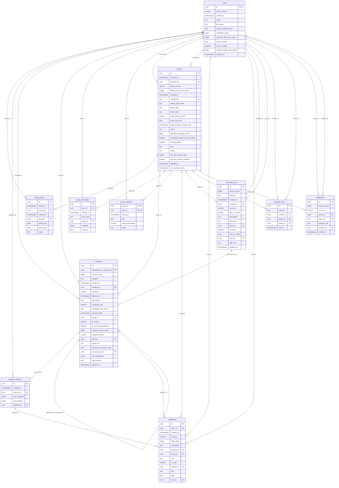

# Entity-Relationship Diagram (ERD)

Deterministically generated from `supabase/migrations/*.sql` via `npm run docs:erd`.

## Tables Summary

| Table | Schema | Columns | Primary Key | Foreign Keys |
| --- | --- | ---: | --- | --- |
| `billing_cycles` | `public` | 8 | `id` | `closed_by`, `group_id` |
| `expense_revisions` | `public` | 6 | `id` | `expense_id`, `updated_by` |
| `expenses` | `public` | 24 | `id` | `adjustment_for_expense_id`, `created_by`, `group_id`, `paid_by`, `recurring_rule_id` |
| `group_audit_logs` | `public` | 7 | `id` | `actor_id`, `group_id` |
| `group_members` | `public` | 6 | `group_id`, `user_id` | `group_id`, `user_id` |
| `groups` | `public` | 23 | `id` | `archived_by`, `created_by` |
| `notifications` | `public` | 14 | `id` | `actor_id`, `expense_id`, `group_id`, `revision_id`, `user_id` |
| `recurring_rules` | `public` | 15 | `id` | `created_by`, `group_id`, `paid_by` |
| `reminder_logs` | `public` | 6 | `id` | `creditor_id`, `debtor_id`, `group_id` |
| `settlements` | `public` | 8 | `id` | `group_id`, `payer_id`, `recipient_id` |
| `users` | `public` | 12 | `id` | `id` |

## External Schema References

- `public.users.id` -> `auth.users.id`
