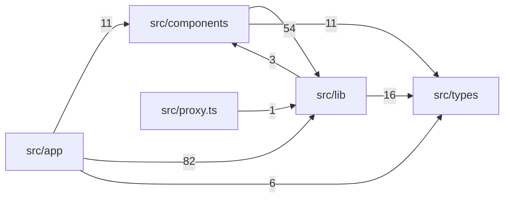

# Source Module Dependency Map

Deterministically generated from `src/` via `dependency-cruiser` (`npm run docs:module-map`).

## Module Dependency Summary

| Module | Files | Internal Imports | Depends On | Depended By |
| --- | ---: | ---: | --- | --- |
| `src/app` | 32 | 100 | `src/components`, `src/lib`, `src/types` | - |
| `src/components` | 40 | 190 | `src/lib`, `src/types` | `src/app`, `src/lib` |
| `src/lib` | 23 | 50 | `src/components`, `src/types` | `src/app`, `src/components`, `src/proxy.ts` |
| `src/proxy.ts` | 1 | 1 | `src/lib` | - |
| `src/types` | 1 | 0 | - | `src/app`, `src/components`, `src/lib` |

## Cross-Module Edges

| From | To | Import Count |
| --- | --- | ---: |
| `src/app` | `src/components` | 11 |
| `src/app` | `src/lib` | 82 |
| `src/app` | `src/types` | 6 |
| `src/components` | `src/lib` | 54 |
| `src/components` | `src/types` | 11 |
| `src/lib` | `src/components` | 3 |
| `src/lib` | `src/types` | 16 |
| `src/proxy.ts` | `src/lib` | 1 |

## Dependency Cruiser Diagnostics

- **Cruised Modules:** 97
- **Errors:** 0
- **Warnings:** 3

| Severity | Rule | From | To / Cycle |
| --- | --- | --- | --- |
| `warn` | `no-circular` | `src/components/expenses/ExpensesClient.tsx` | `src/components/shell/index.ts` -> `src/components/shell/AppShell.tsx` -> `src/components/shell/TopBar.tsx` -> `src/components/expenses/index.ts` -> `src/components/expenses/ExpensesClient.tsx` |
| `warn` | `no-circular` | `src/components/shell/index.ts` | `src/components/shell/TopBar.tsx` -> `src/components/expenses/index.ts` -> `src/components/expenses/ExpensesClient.tsx` -> `src/components/shell/index.ts` |
| `warn` | `no-circular` | `src/lib/groups/archive.ts` | `src/lib/groups/service.ts` -> `src/lib/groups/archive.ts` |
