# Feature & Domain Module Dependency Map

Deterministically generated from `src/` via `dependency-cruiser` (`npm run docs:module-map`).

```mermaid
flowchart LR
    subgraph App_Routes["App Routes"]
        app["src/app"]
        app__app_["src/app/(app)"]
        app__app__dashboard["src/app/(app)/dashboard"]
        app__app__expenses["src/app/(app)/expenses"]
        app__app__settings["src/app/(app)/settings"]
        app__app__split_groups["src/app/(app)/split-groups"]
        app_auth_callback["src/app/auth/callback"]
        app_auth_signout["src/app/auth/signout"]
        app_join["src/app/join"]
        app_login["src/app/login"]
    end
    subgraph API_Routes["API Routes"]
        app_api_account["src/app/api/account"]
        app_api_expenses["src/app/api/expenses"]
        app_api_fx["src/app/api/fx"]
        app_api_groups["src/app/api/groups"]
        app_api_notifications["src/app/api/notifications"]
        app_api_receipts["src/app/api/receipts"]
        app_api_reminders["src/app/api/reminders"]
        app_api_search["src/app/api/search"]
        app_api_settings["src/app/api/settings"]
    end
    subgraph UI_Components["UI Components"]
        components_auth["src/components/auth"]
        components_dashboard["src/components/dashboard"]
        components_expenses["src/components/expenses"]
        components_settings["src/components/settings"]
        components_shell["src/components/shell"]
        components_split_groups["src/components/split-groups"]
        components_ui["src/components/ui"]
    end
    subgraph Domain___Lib["Domain & Lib"]
        lib["src/lib"]
        lib_auth["src/lib/auth"]
        lib_expenses["src/lib/expenses"]
        lib_groups["src/lib/groups"]
        lib_settings["src/lib/settings"]
        lib_supabase["src/lib/supabase"]
    end
    subgraph Shared___Entry["Shared & Entry"]
        proxy_ts["src/proxy.ts"]
        types["src/types"]
    end

    app -->|2| lib_auth
    app__app_ -->|3| components_shell
    app__app_ -->|1| lib_auth
    app__app_ -->|1| lib_supabase
    app__app__dashboard -->|1| components_dashboard
    app__app__dashboard -->|1| lib_auth
    app__app__dashboard -->|1| lib_expenses
    app__app__dashboard -->|1| lib_supabase
    app__app__expenses -->|1| components_expenses
    app__app__expenses -->|1| lib_auth
    app__app__expenses -->|1| lib_expenses
    app__app__expenses -->|1| lib_supabase
    app__app__settings -->|1| components_settings
    app__app__settings -->|1| lib_auth
    app__app__settings -->|1| lib_groups
    app__app__settings -->|2| lib_settings
    app__app__settings -->|1| lib_supabase
    app__app__split_groups -->|1| components_shell
    app__app__split_groups -->|1| components_split_groups
    app__app__split_groups -->|1| components_ui
    app__app__split_groups -->|1| lib_auth
    app__app__split_groups -->|2| lib_groups
    app__app__split_groups -->|1| lib_supabase
    app_api_account -->|1| lib_auth
    app_api_account -->|1| lib_groups
    app_api_account -->|2| lib_supabase
    app_api_expenses -->|1| lib_auth
    app_api_expenses -->|1| lib_expenses
    app_api_expenses -->|1| lib_supabase
    app_api_fx -->|1| lib
    app_api_groups -->|16| lib_auth
    app_api_groups -->|17| lib_groups
    app_api_groups -->|17| lib_supabase
    app_api_groups -->|4| types
    app_api_notifications -->|1| lib_auth
    app_api_notifications -->|1| lib_supabase
    app_api_receipts -->|1| lib_auth
    app_api_receipts -->|1| lib_groups
    app_api_receipts -->|1| lib_supabase
    app_api_reminders -->|1| lib_auth
    app_api_reminders -->|1| lib_groups
    app_api_reminders -->|1| lib_supabase
    app_api_search -->|1| lib_auth
    app_api_search -->|1| lib_expenses
    app_api_search -->|1| lib_supabase
    app_api_settings -->|6| lib_auth
    app_api_settings -->|6| lib_settings
    app_api_settings -->|6| lib_supabase
    app_auth_callback -->|1| lib_auth
    app_auth_callback -->|1| lib_supabase
    app_auth_signout -->|1| lib_auth
    app_auth_signout -->|1| lib_supabase
    app_join -->|1| components_split_groups
    app_join -->|1| lib_auth
    app_join -->|2| lib_groups
    app_join -->|1| lib_supabase
    app_login -->|1| components_auth
    app_login -->|2| lib_auth
    components_auth -->|2| components_ui
    components_auth -->|1| lib_auth
    components_auth -->|1| lib_supabase
    components_dashboard -->|1| components_expenses
    components_dashboard -->|3| components_shell
    components_dashboard -->|2| components_ui
    components_dashboard -->|2| lib
    components_dashboard -->|1| lib_expenses
    components_dashboard -->|2| lib_groups
    components_dashboard -->|1| types
    components_expenses -->|5| components_shell
    components_expenses -->|6| components_ui
    components_expenses -->|4| lib
    components_expenses -->|5| lib_expenses
    components_expenses -->|1| lib_groups
    components_expenses -->|3| types
    components_settings -->|1| components_shell
    components_settings -->|9| components_ui
    components_settings -->|3| lib
    components_settings -->|2| lib_groups
    components_settings -->|6| lib_settings
    components_settings -->|1| lib_supabase
    components_settings -->|2| types
    components_shell -->|1| components_expenses
    components_shell -->|4| components_ui
    components_shell -->|3| lib
    components_shell -->|2| lib_supabase
    components_shell -->|2| types
    components_split_groups -->|1| components_expenses
    components_split_groups -->|6| components_shell
    components_split_groups -->|15| components_ui
    components_split_groups -->|8| lib
    components_split_groups -->|1| lib_expenses
    components_split_groups -->|20| lib_groups
    components_split_groups -->|1| lib_supabase
    components_split_groups -->|6| types
    components_ui -->|15| lib
    lib_auth -->|1| lib_supabase
    lib_expenses -->|2| components_shell
    lib_expenses -->|3| lib
    lib_expenses -->|1| lib_groups
    lib_expenses -->|5| types
    lib_groups -->|2| components_shell
    lib_groups -->|5| lib
    lib_groups -->|5| lib_expenses
    lib_groups -->|1| lib_supabase
    lib_groups -->|9| types
    lib_settings -->|1| lib
    lib_settings -->|1| lib_expenses
    lib_settings -->|3| types
    lib_supabase -->|1| lib_auth
    lib_supabase -->|4| types
    proxy_ts -->|1| lib_supabase
```

## Module Dependency Summary

| Module | Files | Internal Imports | Depends On | Depended By |
| --- | ---: | ---: | --- | --- |
| `src/app` | 3 | 3 | `src/lib/auth` | - |
| `src/app/(app)` | 1 | 5 | `src/components/shell`, `src/lib/auth`, `src/lib/supabase` | - |
| `src/app/(app)/dashboard` | 1 | 4 | `src/components/dashboard`, `src/lib/auth`, `src/lib/expenses`, `src/lib/supabase` | - |
| `src/app/(app)/expenses` | 1 | 4 | `src/components/expenses`, `src/lib/auth`, `src/lib/expenses`, `src/lib/supabase` | - |
| `src/app/(app)/settings` | 1 | 6 | `src/components/settings`, `src/lib/auth`, `src/lib/groups`, `src/lib/settings`, `src/lib/supabase` | - |
| `src/app/(app)/split-groups` | 2 | 7 | `src/components/shell`, `src/components/split-groups`, `src/components/ui`, `src/lib/auth`, `src/lib/groups`, `src/lib/supabase` | - |
| `src/app/api/account` | 1 | 4 | `src/lib/auth`, `src/lib/groups`, `src/lib/supabase` | - |
| `src/app/api/expenses` | 1 | 3 | `src/lib/auth`, `src/lib/expenses`, `src/lib/supabase` | - |
| `src/app/api/fx` | 1 | 1 | `src/lib` | - |
| `src/app/api/groups` | 16 | 54 | `src/lib/auth`, `src/lib/groups`, `src/lib/supabase`, `src/types` | - |
| `src/app/api/notifications` | 1 | 2 | `src/lib/auth`, `src/lib/supabase` | - |
| `src/app/api/receipts` | 1 | 3 | `src/lib/auth`, `src/lib/groups`, `src/lib/supabase` | - |
| `src/app/api/reminders` | 1 | 3 | `src/lib/auth`, `src/lib/groups`, `src/lib/supabase` | - |
| `src/app/api/search` | 1 | 3 | `src/lib/auth`, `src/lib/expenses`, `src/lib/supabase` | - |
| `src/app/api/settings` | 6 | 18 | `src/lib/auth`, `src/lib/settings`, `src/lib/supabase` | - |
| `src/app/auth/callback` | 1 | 2 | `src/lib/auth`, `src/lib/supabase` | - |
| `src/app/auth/signout` | 1 | 2 | `src/lib/auth`, `src/lib/supabase` | - |
| `src/app/join` | 1 | 5 | `src/components/split-groups`, `src/lib/auth`, `src/lib/groups`, `src/lib/supabase` | - |
| `src/app/login` | 1 | 3 | `src/components/auth`, `src/lib/auth` | - |
| `src/components/auth` | 2 | 4 | `src/components/ui`, `src/lib/auth`, `src/lib/supabase` | `src/app/login` |
| `src/components/dashboard` | 1 | 12 | `src/components/expenses`, `src/components/shell`, `src/components/ui`, `src/lib`, `src/lib/expenses`, `src/lib/groups`, `src/types` | `src/app/(app)/dashboard` |
| `src/components/expenses` | 4 | 32 | `src/components/shell`, `src/components/ui`, `src/lib`, `src/lib/expenses`, `src/lib/groups`, `src/types` | `src/app/(app)/expenses`, `src/components/dashboard`, `src/components/shell`, `src/components/split-groups` |
| `src/components/settings` | 6 | 38 | `src/components/shell`, `src/components/ui`, `src/lib`, `src/lib/groups`, `src/lib/settings`, `src/lib/supabase`, `src/types` | `src/app/(app)/settings` |
| `src/components/shell` | 8 | 38 | `src/components/expenses`, `src/components/ui`, `src/lib`, `src/lib/supabase`, `src/types` | `src/app/(app)`, `src/app/(app)/split-groups`, `src/components/dashboard`, `src/components/expenses`, `src/components/settings`, `src/components/split-groups`, `src/lib/expenses`, `src/lib/groups` |
| `src/components/split-groups` | 9 | 79 | `src/components/expenses`, `src/components/shell`, `src/components/ui`, `src/lib`, `src/lib/expenses`, `src/lib/groups`, `src/lib/supabase`, `src/types` | `src/app/(app)/split-groups`, `src/app/join` |
| `src/components/ui` | 17 | 50 | `src/lib` | `src/app/(app)/split-groups`, `src/components/auth`, `src/components/dashboard`, `src/components/expenses`, `src/components/settings`, `src/components/shell`, `src/components/split-groups` |
| `src/lib` | 3 | 0 | - | `src/app/api/fx`, `src/components/dashboard`, `src/components/expenses`, `src/components/settings`, `src/components/shell`, `src/components/split-groups`, `src/components/ui`, `src/lib/expenses`, `src/lib/groups`, `src/lib/settings` |
| `src/lib/auth` | 2 | 2 | `src/lib/supabase` | `src/app`, `src/app/(app)`, `src/app/(app)/dashboard`, `src/app/(app)/expenses`, `src/app/(app)/settings`, `src/app/(app)/split-groups`, `src/app/api/account`, `src/app/api/expenses`, `src/app/api/groups`, `src/app/api/notifications`, `src/app/api/receipts`, `src/app/api/reminders`, `src/app/api/search`, `src/app/api/settings`, `src/app/auth/callback`, `src/app/auth/signout`, `src/app/join`, `src/app/login`, `src/components/auth`, `src/lib/supabase` |
| `src/lib/expenses` | 5 | 14 | `src/components/shell`, `src/lib`, `src/lib/groups`, `src/types` | `src/app/(app)/dashboard`, `src/app/(app)/expenses`, `src/app/api/expenses`, `src/app/api/search`, `src/components/dashboard`, `src/components/expenses`, `src/components/split-groups`, `src/lib/groups`, `src/lib/settings` |
| `src/lib/groups` | 10 | 40 | `src/components/shell`, `src/lib`, `src/lib/expenses`, `src/lib/supabase`, `src/types` | `src/app/(app)/settings`, `src/app/(app)/split-groups`, `src/app/api/account`, `src/app/api/groups`, `src/app/api/receipts`, `src/app/api/reminders`, `src/app/join`, `src/components/dashboard`, `src/components/expenses`, `src/components/settings`, `src/components/split-groups`, `src/lib/expenses` |
| `src/lib/settings` | 3 | 6 | `src/lib`, `src/lib/expenses`, `src/types` | `src/app/(app)/settings`, `src/app/api/settings`, `src/components/settings` |
| `src/lib/supabase` | 5 | 7 | `src/lib/auth`, `src/types` | `src/app/(app)`, `src/app/(app)/dashboard`, `src/app/(app)/expenses`, `src/app/(app)/settings`, `src/app/(app)/split-groups`, `src/app/api/account`, `src/app/api/expenses`, `src/app/api/groups`, `src/app/api/notifications`, `src/app/api/receipts`, `src/app/api/reminders`, `src/app/api/search`, `src/app/api/settings`, `src/app/auth/callback`, `src/app/auth/signout`, `src/app/join`, `src/components/auth`, `src/components/settings`, `src/components/shell`, `src/components/split-groups`, `src/lib/auth`, `src/lib/groups`, `src/proxy.ts` |
| `src/proxy.ts` | 1 | 1 | `src/lib/supabase` | - |
| `src/types` | 1 | 0 | - | `src/app/api/groups`, `src/components/dashboard`, `src/components/expenses`, `src/components/settings`, `src/components/shell`, `src/components/split-groups`, `src/lib/expenses`, `src/lib/groups`, `src/lib/settings`, `src/lib/supabase` |

## Cross-Module Edges

| From | To | Import Count |
| --- | --- | ---: |
| `src/app` | `src/lib/auth` | 2 |
| `src/app/(app)` | `src/components/shell` | 3 |
| `src/app/(app)` | `src/lib/auth` | 1 |
| `src/app/(app)` | `src/lib/supabase` | 1 |
| `src/app/(app)/dashboard` | `src/components/dashboard` | 1 |
| `src/app/(app)/dashboard` | `src/lib/auth` | 1 |
| `src/app/(app)/dashboard` | `src/lib/expenses` | 1 |
| `src/app/(app)/dashboard` | `src/lib/supabase` | 1 |
| `src/app/(app)/expenses` | `src/components/expenses` | 1 |
| `src/app/(app)/expenses` | `src/lib/auth` | 1 |
| `src/app/(app)/expenses` | `src/lib/expenses` | 1 |
| `src/app/(app)/expenses` | `src/lib/supabase` | 1 |
| `src/app/(app)/settings` | `src/components/settings` | 1 |
| `src/app/(app)/settings` | `src/lib/auth` | 1 |
| `src/app/(app)/settings` | `src/lib/groups` | 1 |
| `src/app/(app)/settings` | `src/lib/settings` | 2 |
| `src/app/(app)/settings` | `src/lib/supabase` | 1 |
| `src/app/(app)/split-groups` | `src/components/shell` | 1 |
| `src/app/(app)/split-groups` | `src/components/split-groups` | 1 |
| `src/app/(app)/split-groups` | `src/components/ui` | 1 |
| `src/app/(app)/split-groups` | `src/lib/auth` | 1 |
| `src/app/(app)/split-groups` | `src/lib/groups` | 2 |
| `src/app/(app)/split-groups` | `src/lib/supabase` | 1 |
| `src/app/api/account` | `src/lib/auth` | 1 |
| `src/app/api/account` | `src/lib/groups` | 1 |
| `src/app/api/account` | `src/lib/supabase` | 2 |
| `src/app/api/expenses` | `src/lib/auth` | 1 |
| `src/app/api/expenses` | `src/lib/expenses` | 1 |
| `src/app/api/expenses` | `src/lib/supabase` | 1 |
| `src/app/api/fx` | `src/lib` | 1 |
| `src/app/api/groups` | `src/lib/auth` | 16 |
| `src/app/api/groups` | `src/lib/groups` | 17 |
| `src/app/api/groups` | `src/lib/supabase` | 17 |
| `src/app/api/groups` | `src/types` | 4 |
| `src/app/api/notifications` | `src/lib/auth` | 1 |
| `src/app/api/notifications` | `src/lib/supabase` | 1 |
| `src/app/api/receipts` | `src/lib/auth` | 1 |
| `src/app/api/receipts` | `src/lib/groups` | 1 |
| `src/app/api/receipts` | `src/lib/supabase` | 1 |
| `src/app/api/reminders` | `src/lib/auth` | 1 |
| `src/app/api/reminders` | `src/lib/groups` | 1 |
| `src/app/api/reminders` | `src/lib/supabase` | 1 |
| `src/app/api/search` | `src/lib/auth` | 1 |
| `src/app/api/search` | `src/lib/expenses` | 1 |
| `src/app/api/search` | `src/lib/supabase` | 1 |
| `src/app/api/settings` | `src/lib/auth` | 6 |
| `src/app/api/settings` | `src/lib/settings` | 6 |
| `src/app/api/settings` | `src/lib/supabase` | 6 |
| `src/app/auth/callback` | `src/lib/auth` | 1 |
| `src/app/auth/callback` | `src/lib/supabase` | 1 |
| `src/app/auth/signout` | `src/lib/auth` | 1 |
| `src/app/auth/signout` | `src/lib/supabase` | 1 |
| `src/app/join` | `src/components/split-groups` | 1 |
| `src/app/join` | `src/lib/auth` | 1 |
| `src/app/join` | `src/lib/groups` | 2 |
| `src/app/join` | `src/lib/supabase` | 1 |
| `src/app/login` | `src/components/auth` | 1 |
| `src/app/login` | `src/lib/auth` | 2 |
| `src/components/auth` | `src/components/ui` | 2 |
| `src/components/auth` | `src/lib/auth` | 1 |
| `src/components/auth` | `src/lib/supabase` | 1 |
| `src/components/dashboard` | `src/components/expenses` | 1 |
| `src/components/dashboard` | `src/components/shell` | 3 |
| `src/components/dashboard` | `src/components/ui` | 2 |
| `src/components/dashboard` | `src/lib` | 2 |
| `src/components/dashboard` | `src/lib/expenses` | 1 |
| `src/components/dashboard` | `src/lib/groups` | 2 |
| `src/components/dashboard` | `src/types` | 1 |
| `src/components/expenses` | `src/components/shell` | 5 |
| `src/components/expenses` | `src/components/ui` | 6 |
| `src/components/expenses` | `src/lib` | 4 |
| `src/components/expenses` | `src/lib/expenses` | 5 |
| `src/components/expenses` | `src/lib/groups` | 1 |
| `src/components/expenses` | `src/types` | 3 |
| `src/components/settings` | `src/components/shell` | 1 |
| `src/components/settings` | `src/components/ui` | 9 |
| `src/components/settings` | `src/lib` | 3 |
| `src/components/settings` | `src/lib/groups` | 2 |
| `src/components/settings` | `src/lib/settings` | 6 |
| `src/components/settings` | `src/lib/supabase` | 1 |
| `src/components/settings` | `src/types` | 2 |
| `src/components/shell` | `src/components/expenses` | 1 |
| `src/components/shell` | `src/components/ui` | 4 |
| `src/components/shell` | `src/lib` | 3 |
| `src/components/shell` | `src/lib/supabase` | 2 |
| `src/components/shell` | `src/types` | 2 |
| `src/components/split-groups` | `src/components/expenses` | 1 |
| `src/components/split-groups` | `src/components/shell` | 6 |
| `src/components/split-groups` | `src/components/ui` | 15 |
| `src/components/split-groups` | `src/lib` | 8 |
| `src/components/split-groups` | `src/lib/expenses` | 1 |
| `src/components/split-groups` | `src/lib/groups` | 20 |
| `src/components/split-groups` | `src/lib/supabase` | 1 |
| `src/components/split-groups` | `src/types` | 6 |
| `src/components/ui` | `src/lib` | 15 |
| `src/lib/auth` | `src/lib/supabase` | 1 |
| `src/lib/expenses` | `src/components/shell` | 2 |
| `src/lib/expenses` | `src/lib` | 3 |
| `src/lib/expenses` | `src/lib/groups` | 1 |
| `src/lib/expenses` | `src/types` | 5 |
| `src/lib/groups` | `src/components/shell` | 2 |
| `src/lib/groups` | `src/lib` | 5 |
| `src/lib/groups` | `src/lib/expenses` | 5 |
| `src/lib/groups` | `src/lib/supabase` | 1 |
| `src/lib/groups` | `src/types` | 9 |
| `src/lib/settings` | `src/lib` | 1 |
| `src/lib/settings` | `src/lib/expenses` | 1 |
| `src/lib/settings` | `src/types` | 3 |
| `src/lib/supabase` | `src/lib/auth` | 1 |
| `src/lib/supabase` | `src/types` | 4 |
| `src/proxy.ts` | `src/lib/supabase` | 1 |

## Dependency Cruiser Diagnostics

- **Cruised Modules:** 119
- **Errors:** 0
- **Warnings:** 3

| Severity | Rule | From | To / Cycle |
| --- | --- | --- | --- |
| `warn` | `no-circular` | `src/components/expenses/ExpensesClient.tsx` | `src/components/shell/index.ts` -> `src/components/shell/AppShell.tsx` -> `src/components/shell/TopBar.tsx` -> `src/components/expenses/index.ts` -> `src/components/expenses/ExpensesClient.tsx` |
| `warn` | `no-circular` | `src/components/shell/index.ts` | `src/components/shell/TopBar.tsx` -> `src/components/expenses/index.ts` -> `src/components/expenses/ExpensesClient.tsx` -> `src/components/shell/index.ts` |
| `warn` | `no-circular` | `src/lib/groups/archive.ts` | `src/lib/groups/service.ts` -> `src/lib/groups/archive.ts` |
